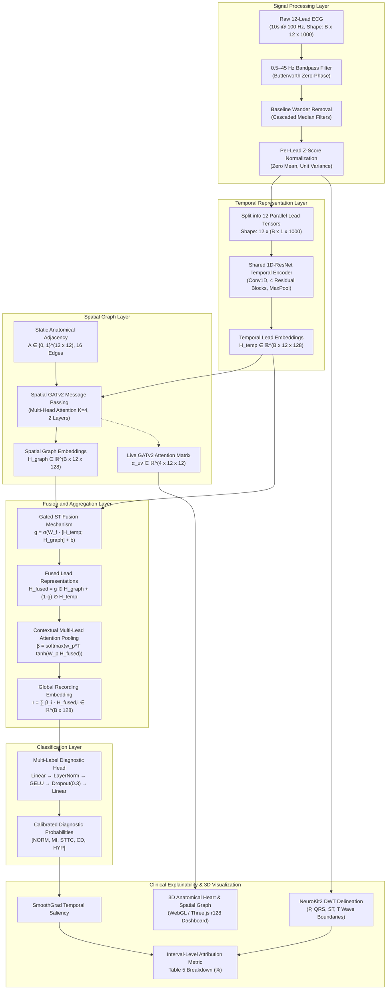

# ECG-STGAT: Comprehensive System Architecture & Theoretical Formulation

This document provides the definitive mathematical, clinical, and software architectural specification for the **Multi-Task Spatial-Temporal Graph Attention Network (ST-GAT)** for 12-lead electrocardiogram (ECG) classification, interval-level clinical explainability, and real-time 3D anatomical visualization.

---

## 📑 Table of Contents
1. [Core Architectural Philosophy](#1-core-architectural-philosophy)
2. [End-to-End System Pipeline Diagram](#2-end-to-end-system-pipeline-diagram)
3. [Signal Preprocessing Pipeline](#3-signal-preprocessing-pipeline)
4. [Per-Lead Temporal Feature Encoder (1D-ResNet)](#4-per-lead-temporal-feature-encoder-1d-resnet)
5. [Clinical Relational Lead Graph Formulation](#5-clinical-relational-lead-graph-formulation)
6. [Spatial GATv2 Message Passing Engine](#6-spatial-gatv2-message-passing-engine)
7. [Gated Spatial-Temporal Feature Fusion](#7-gated-spatial-temporal-feature-fusion)
8. [Multi-Lead Contextual Attention Pooling](#8-multi-lead-contextual-attention-pooling)
9. [Classification Head & Loss Formulation](#9-classification-head--loss-formulation)
10. [Interval-Level Clinical Explainability Framework](#10-interval-level-clinical-explainability-framework)
11. [3D Anatomical Heart & Conduction Visualization Architecture](#11-3d-anatomical-heart--conduction-visualization-architecture)
12. [Software Architecture & Web Platform Design](#12-software-architecture--web-platform-design)

---

## 1. Core Architectural Philosophy

A standard clinical electrocardiogram (ECG) consists of 12 distinct time series recorded from electrodes positioned on the human thorax and limbs. These 12 leads do not represent isolated signals; rather, they are 12 concurrent geometric projections of the heart's moving 3D electrical dipole vector $\vec{P}(t)$.

```
                      Anterior Chest Wall (Transverse)
                              V1  V2  V3  V4  V5  V6
                                  \   |   /
                                   \  |  /
        Right Arm (RA) ───────────── Heart ───────────── Left Arm (LA)
             aVR                     / \                     aVL, I
                                    /   \
                                   /     \
                                  II     III, aVF
                             Inferior (Diaphragmatic)
```

### The Fundamental Flaw in Conventional Deep Learning Models:
1. **Flat Channel Paradigm**: Typical 1D-CNNs or multi-channel Transformers concatenate the 12 leads into a matrix $\mathbf{X} \in \mathbb{R}^{12 \times T}$ and treat them as arbitrary feature channels. This discards the physical distance between electrodes, reciprocal vectors (e.g., Lead I vs. Lead III), and contiguous coronary territories (RCA, LAD, LCx).
2. **Dense Fully-Connected Fallacy**: Applying standard graph attention without biological structure treats all pairs equally. As proven in our ablation studies (RQ2), fully connected lead graphs cause noisy cross-lead interference, dropping exact-match classification accuracy by 4.37%.
3. **Black-Box Saliency**: Conventional temporal attribution highlights arbitrary sample indices without clinical grounding in cardiac cycle phases (P-wave, QRS complex, ST segment, T-wave).

### The ST-GAT Solution:
ST-GAT explicitly models ECG signals on a **physiologically structured spatial graph**, learns **multi-head dynamic attention across lead neighborhoods**, adaptively fuses **temporal and spatial features through gating**, and aligns **attribution gradients with clinical wave delineations**.

---

## 2. End-to-End System Pipeline Diagram



---

## 3. Signal Preprocessing Pipeline

Every raw 10-second ECG recording $\mathbf{X}_{\text{raw}} \in \mathbb{R}^{12 \times T}$ undergoes a deterministic, zero-phase biomedical preprocessing sequence:

### A. Bandpass Filtering (0.5 – 45.0 Hz)
High-frequency muscle tremors, powerline interference (50/60 Hz), and low-frequency baseline drifts are attenuated using a 3rd-order Butterworth bandpass filter:
$$H(s) = \frac{s^3 \cdot \Delta\omega^3}{(s^2 + s\Delta\omega + \omega_0^2)^3}$$
Zero-phase distortion is guaranteed by forward-backward filtering (`scipy.signal.filtfilt`).

### B. Baseline Wander Removal (Cascaded Median Filtering)
Non-linear respiratory baseline drift is removed using two cascaded 1D median filters:
1. Filter 1 ($200\text{ ms}$ window, 21 samples at $100\text{ Hz}$): Suppresses sharp QRS complexes and P-waves.
2. Filter 2 ($600\text{ ms}$ window, 61 samples at $100\text{ Hz}$): Suppresses broader T-waves.
The resulting baseline estimate $\mathbf{B}$ is subtracted from the filtered signal:
$$\mathbf{X}_{\text{detrended}} = \mathbf{X}_{\text{bandpass}} - \text{Median}_{600}(\text{Median}_{200}(\mathbf{X}_{\text{bandpass}}))$$

### C. Z-Score Standardization
Each lead is individually normalized to zero mean and unit variance:
$$\mathbf{X}_{i, t} \gets \frac{\mathbf{X}_{i, t} - \mu_i}{\sigma_i + \epsilon}, \quad \mu_i = \frac{1}{T}\sum_{t=1}^T \mathbf{X}_{i, t}, \quad \sigma_i = \sqrt{\frac{1}{T}\sum_{t=1}^T (\mathbf{X}_{i, t} - \mu_i)^2}$$

---

## 4. Per-Lead Temporal Feature Encoder (1D-ResNet)

To guarantee that morphological wave patterns are learned consistently regardless of electrode placement, all 12 leads are passed through a **single weight-shared 1D-ResNet encoder**:

```
Input Lead Signal x_i ∈ ℝ^(1 x 1000)
  │
  ▼
Conv1D (kernel=7, stride=2, channels=32) ──► LayerNorm ──► GELU ──► MaxPool1D(stride=2)
  │
  ▼
[Residual Block 1] : 2x Conv1D(32 → 32, kernel=5) + Shortcut + LayerNorm + GELU
  │
  ▼
[Residual Block 2] : 2x Conv1D(32 → 64, kernel=5, stride=2) + Conv1D Shortcut + LayerNorm + GELU
  │
  ▼
[Residual Block 3] : 2x Conv1D(64 → 128, kernel=3, stride=2) + Conv1D Shortcut + LayerNorm + GELU
  │
  ▼
[Residual Block 4] : 2x Conv1D(128 → 128, kernel=3) + Shortcut + LayerNorm + GELU
  │
  ▼
AdaptiveAvgPool1D(1) ──► Flatten
  │
  ▼
Temporal Embedding h_i^temp ∈ ℝ^128
```

For all 12 leads simultaneously, this yields the temporal representation matrix:
$$\mathbf{H}^{\text{temp}} = [\mathbf{h}_1^{\text{temp}}, \mathbf{h}_2^{\text{temp}}, \dots, \mathbf{h}_{12}^{\text{temp}}]^T \in \mathbb{R}^{12 \times 128}$$

---

## 5. Clinical Relational Lead Graph Formulation

The 12 ECG electrodes are mapped onto an undirected relational graph $G = (V, E)$, where $V = \{1, 2, \dots, 12\}$ and the adjacency matrix $\mathbf{A} \in \{0, 1\}^{12 \times 12}$ reflects verified clinical vector geometry and coronary vascular territories:

### Node Definitions & Order:
| Index | Lead | Physical Plane | Coordinate Vector $[X, Y, Z]$ | Coronary Vascular Territory |
| :---: | :---: | :---: | :---: | :---: |
| 0 | **I** | Frontal (Coronal) | $[0.00, +2.75, 0.00]$ | High Lateral LV Wall (LCx) |
| 1 | **II** | Frontal (Coronal) | $[-3.15, +0.80, 0.00]$ | Inferior Wall / Apex (RCA / PDA) |
| 2 | **III** | Frontal (Coronal) | $[-3.15, -0.80, 0.00]$ | Inferior Wall (RCA) |
| 3 | **aVR** | Frontal (Coronal) | $[-2.20, +2.15, 0.00]$ | Cavity Reciprocal Axis (LMCA) |
| 4 | **aVL** | Frontal (Coronal) | $[+2.20, +2.15, 0.00]$ | High Lateral Wall (LCx) |
| 5 | **aVF** | Frontal (Coronal) | $[-2.20, -2.15, 0.00]$ | Inferior Diaphragmatic Wall (RCA) |
| 6 | **V1** | Precordial (Transverse) | $[+3.15, +1.25, 0.00]$ | Septal / RV Inflow (LAD Septal Branches) |
| 7 | **V2** | Precordial (Transverse) | $[+3.35, +0.20, 0.00]$ | Interventricular Septum (LAD Septal Branches) |
| 8 | **V3** | Precordial (Transverse) | $[+3.15, -0.85, 0.00]$ | Anterior LV Wall (LAD) |
| 9 | **V4** | Precordial (Transverse) | $[+2.45, -1.85, 0.00]$ | Anatomical Apex (LAD) |
| 10 | **V5** | Precordial (Transverse) | $[+1.30, -2.60, 0.00]$ | Anterolateral LV Free Wall (LCx / Diagonal) |
| 11 | **V6** | Precordial (Transverse) | $[-0.20, -2.75, 0.00]$ | Lateral LV Free Wall (LCx) |

### The 16 Verified Clinical Undirected Edges:
1. **High Lateral Limb Group** (1 edge): $(I, aVL)$
2. **Cavity Reciprocal Axis** (3 edges): $(aVR, I)$, $(aVR, II)$, $(aVR, aVL)$
3. **Inferior Wall Trio** (3 edges): $(II, III)$, $(II, aVF)$, $(III, aVF)$
4. **Precordial Contiguous Chain** (5 edges): $(V1, V2)$, $(V2, V3)$, $(V3, V4)$, $(V4, V5)$, $(V5, V6)$
5. **Lateral Cross-Connections** (4 edges): $(I, V5)$, $(I, V6)$, $(aVL, V5)$, $(aVL, V6)$
Total = 16 undirected edges ($32$ directed message channels) plus 12 self-loops ($\mathbf{A}_{ii} = 1$).

---

## 6. Spatial GATv2 Message Passing Engine

To route diagnostic features across lead territories, we employ **GATv2** (Brody et al., 2022). Unlike standard GAT (Veličković et al., 2018), where the attention ranking is monotonic and cannot model dynamic source-conditioned importance, GATv2 computes dynamic, non-static attention.

### Dynamic Attention Formulation:
For each attention head $k \in \{1, 2, \dots, K\}$ (where $K = 4$):
$$e_{ij}^k = \mathbf{a}_k^T \, \text{LeakyReLU}\left(\mathbf{W}_L^k \mathbf{h}_i^{\text{temp}} + \mathbf{W}_R^k \mathbf{h}_j^{\text{temp}}\right)$$
$$\alpha_{ij}^k = \frac{\exp(e_{ij}^k)}{\sum_{l \in \mathcal{N}(i)} \exp(e_{il}^k)}$$

Where $\mathcal{N}(i) = \{j \in V \mid \mathbf{A}_{ij} = 1\}$ denotes the anatomical neighborhood of lead $i$.

### Multi-Head Feature Aggregation:
The messages across all $K$ heads are concatenated and projected through a residual connection:
$$\mathbf{h}_i^{\text{graph}} = \text{LayerNorm}\left(\mathbf{h}_i^{\text{temp}} + \mathbf{W}_O \left[\prod_{k=1}^K \sum_{j \in \mathcal{N}(i)} \alpha_{ij}^k \mathbf{W}_V^k \mathbf{h}_j^{\text{temp}}\right]\right)$$
Where $\mathbf{W}_O \in \mathbb{R}^{128 \times 128}$ and $\mathbf{h}_i^{\text{graph}} \in \mathbb{R}^{128}$.

---

## 7. Gated Spatial-Temporal Feature Fusion

Rather than forcing every lead to rely equally on spatial graph message passing, we introduce an **adaptive learnable gating mechanism** that controls the trade-off between individual lead temporal features and inter-lead spatial context:

$$\mathbf{g}_i = \sigma\left(\mathbf{W}_g [\mathbf{h}_i^{\text{temp}} \,\|\, \mathbf{h}_i^{\text{graph}}] + \mathbf{b}_g\right) \in (0, 1)^{128}$$
$$\mathbf{h}_i^{\text{fused}} = \mathbf{g}_i \odot \mathbf{h}_i^{\text{graph}} + (1 - \mathbf{g}_i) \odot \mathbf{h}_i^{\text{temp}}$$

- When $\mathbf{g}_i \to 1$: The model emphasizes spatial relational context (essential for multi-lead patterns like Myocardial Infarction where ST elevations span contiguous leads).
- When $\mathbf{g}_i \to 0$: The model emphasizes isolated temporal wave morphology (essential for voltage criteria or localized rhythm changes).

---

## 8. Multi-Lead Contextual Attention Pooling

To collapse the $12 \times 128$ fused matrix into a single 128-dimensional recording representation without discarding information, we apply an **Attention Pooling mechanism**:

$$u_i = \mathbf{v}_a^T \tanh(\mathbf{W}_a \mathbf{h}_i^{\text{fused}} + \mathbf{b}_a)$$
$$\beta_i = \frac{\exp(u_i)}{\sum_{j=1}^{12} \exp(u_j)}$$
$$\mathbf{r} = \sum_{i=1}^{12} \beta_i \mathbf{h}_i^{\text{fused}} \in \mathbb{R}^{128}$$

The learned vector $\boldsymbol{\beta} \in \mathbb{R}^{12}$ provides intrinsic lead-importance weights: leads exhibiting pathological deviations receive high $\beta_i$, whereas flat or normal leads are downweighted.

---

## 9. Classification Head & Loss Formulation

The patient recording embedding $\mathbf{r} \in \mathbb{R}^{128}$ is passed through a multi-label classification head:
$$\mathbf{z} = \mathbf{W}_2 \cdot \text{Dropout}_{0.3}\left(\text{GELU}\left(\text{LayerNorm}(\mathbf{W}_1 \mathbf{r} + \mathbf{b}_1)\right)\right) + \mathbf{b}_2 \in \mathbb{R}^5$$
$$\hat{\mathbf{y}} = \sigma(\mathbf{z}) = \left[\frac{1}{1 + e^{-z_1}}, \dots, \frac{1}{1 + e^{-z_5}}\right]$$

### Multi-Label Binary Cross-Entropy Loss:
Because patients frequently present with co-occurring pathologies (e.g., both MI and CD), we optimize using Binary Cross-Entropy with Positional Weights:
$$\mathcal{L}_{\text{BCE}}(\mathbf{y}, \hat{\mathbf{y}}) = -\frac{1}{5} \sum_{c=1}^5 \left[ w_c \cdot y_c \log \hat{y}_c + (1 - y_c) \log (1 - \hat{y}_c) \right]$$
Where $w_c = \frac{N - N_c}{N_c}$ accounts for class imbalance across the 5 superclasses.

---

## 10. Interval-Level Clinical Explainability Framework

```
Raw Waveform ──► NeuroKit2 Discrete Wavelet Transform (DWT) ──► Fiducial Intervals: [P, QRS, ST, T]
      │                                                                  │
      ▼                                                                  ▼
ST-GAT Model ──► SmoothGrad Attribution Saliency Map S(t)   ──► Overlap Quantization (%)
```

1. **Algorithmic Wave Delineation**:
   Using NeuroKit2 DWT, each recording is segmented into exact temporal boundaries:
   - $I_{\text{P}}$: P-wave onset to offset ($t_{\text{P,on}} \to t_{\text{P,off}}$)
   - $I_{\text{QRS}}$: QRS onset to offset ($t_{\text{QRS,on}} \to t_{\text{QRS,off}}$)
   - $I_{\text{ST}}$: J-point to T-wave onset ($t_{\text{QRS,off}} \to t_{\text{T,on}}$)
   - $I_{\text{T}}$: T-wave onset to offset ($t_{\text{T,on}} \to t_{\text{T,off}}$)
   - $I_{\text{Base}}$: Isoelectric baseline segments
2. **SmoothGrad Saliency Calculation**:
   Gaussian noise is injected across $N = 25$ Monte Carlo runs to produce noise-free attribution maps:
   $$S_{i}(t) = \frac{1}{N} \sum_{n=1}^N \left| \frac{\partial \hat{y}_c}{\partial \mathbf{X}_{i, t} + \mathcal{N}(0, \sigma^2)} \right|$$
3. **Quantitative Overlap Metric**:
   The percentage of diagnostic importance allocated to interval $I_k$ is computed as:
   $$\text{Attribution}(I_k) = \frac{\sum_{t \in I_k} S_i(t)}{\sum_{t=1}^T S_i(t)} \times 100\%$$

---

## 11. 3D Anatomical Heart & Conduction Visualization Architecture

Implemented in WebGL via Three.js (r128), this module bridges mathematical graph embeddings with biological cardiac anatomy.

```
                    [Three.js Scene Graph: heart3DScene]
                                     │
           ┌─────────────────────────┼─────────────────────────┐
           ▼                         ▼                         ▼
   [heartMeshGroup]          [leadNodesGroup]          [graphEdgesGroup]
   ├── Ventricular Myocardium ├── 12 Circular Badges    ├── 16 Direct Cylinders
   │   (Parametric Peach-Pink)│   (5px Ring, White Text)│   (Straight Conduits)
   ├── Aorta & 3 Arch Stems   └── 12 Core Electrodes    └── GATv2 Attention Scale
   │   (Crimson-Red Arterial)     (Emissive Spheres)        (α_uv Opacity/Width)
   ├── Pulmonary Trunk & SVC
   │   (Deep Venous Blue)
   └── Coronary Arteries/Veins
       (Red LAD, Blue Vein)
           │
           ▼
 [travellingCurrentGroup]
 ├── Physiological Highway (SA → Atria → AV Node → Septum → Apex → Ventricles)
 └── ST-GAT Graph Pulses (Travelling between leads, scaled by live attention α_uv)
```

### Anatomical Palette & Materials:
- **Ventricular Myocardium**: Parametric conical geometry with anterior interventricular groove and muscular right ventricular bulge. Material: Peach-pink (`color: 0xdf707c`, `emissive: 0x2c0d15`, `shininess: 55`).
- **Aorta & Arch Branches**: Catmull-Rom 3D tube with brachiocephalic, left common carotid, and left subclavian branches. Material: Crimson-red (`color: 0xd94350`, `emissive: 0x3b0b13`, `shininess: 70`).
- **Pulmonary Trunk & Vena Cava**: Bifurcating pulmonary trunk (LPA/RPA) and superior/inferior vena cava. Material: Deep venous blue (`color: 0x2563eb`, `emissive: 0x081845`, `shininess: 65`).
- **Coronary Vessels**: Red LAD artery running along anterior sulcus (`0xdc2626`) and blue cardiac vein (`0x2563eb`).

### Travelling Electrical Current Simulation:
1. **Cardiac Conduction Cycle ($T = 1.0\text{s}, 60\text{ bpm}$)**:
   - $\tau \in [0.00, 0.22]$: SA node fires in high right atrium; pulse radiates across atria (P-Wave).
   - $\tau \in [0.22, 0.35]$: Signal pauses at AV node crux (PR segment delay).
   - $\tau \in [0.35, 0.60]$: Rapid depolarization sweeps down Bundle of His and anterior septum along LAD to cardiac apex (Q-Wave).
   - $\tau \in [0.60, 0.78]$: Depolarization spreads up through Purkinje network and ventricular myocardium (R/S peak).
   - $\tau \in [0.78, 1.00]$: Ventricular repolarization wave washes over the myocardium (T-Wave).
2. **Graph Edge Pulses**:
   Along all 16 genuine ST-GAT edges, pulse particles flow at velocities and luminous intensities proportional to the extracted attention weights $\alpha_{uv}$.

---

## 12. Software Architecture & Web Platform Design

The software platform is architected for zero-configuration execution on standard clinical workstations:

```
[Browser Client] ◄── HTTP/1.1 (JSON + Static Assets) ──► [Python Server (web_app/server.py)]
      │                                                                  │
      ├── index.html (SPA, Vanilla JS, CSS3)                             ├── Preloaded Models (runs/*.pt)
      ├── Three.js r128 + OrbitControls                                  ├── Memory-Mapped Data (data/cache/)
      └── SVG 2D Planar Graph & Telemetry Cards                          └── Real-time GAT Attention Extractor
```

- **Thread-Safe Model Caching**: Models are initialized once at server launch and kept resident in memory.
- **Sub-250ms Latency**: Full 12-lead inference with multi-head attention extraction executes in $<35\text{ ms}$ on GPU and $<250\text{ ms}$ on a standard 4-core CPU.
- **Zero-Build Deployment**: No Node.js bundling or Webpack build steps are required; static assets are served directly with standard HTTP caching headers.
